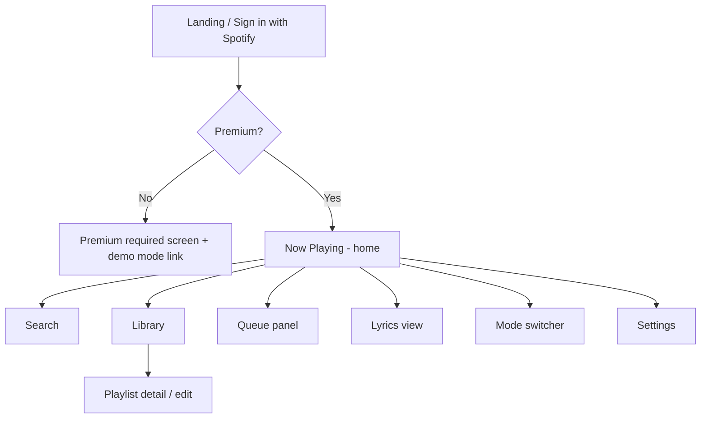

# PRD: Ambient Music Player for Spotify

| | |
|---|---|
| **Working title** | *Aura* |
| **Type** | Personal / portfolio web app |
| **Owner** | You |
| **Status** | v1.0 — Decisions locked |
| **Last updated** | 2026-11-25 |

---

## 1. Summary

A visual-first web player for Spotify. The current track fills the screen: the cover art sets the colours, a generative visualizer moves with playback, and synced lyrics scroll in time. Users pick a **mode** (Focus, Chill, Night) that changes how the screen looks and behaves. Search, library, playlist editing and queue are all there, but they stay in the background so the screen can stay calm.

Playback happens in the browser through the **Spotify Web Playback SDK**. Each listener needs **Spotify Premium**.

## 2. Problem and opportunity

- Spotify's own clients are built for browsing and finding music. The now-playing screen is small and busy. Nothing in them is meant to sit on a second monitor for hours while you work, relax or fall asleep.
- Existing "ambient" visualizers mostly don't connect to Spotify, or they only show what's playing without letting you control it.
- **Opportunity:** a complete, nice-looking Spotify player where the now-playing view *is* the product. It doubles as a design and frontend portfolio piece.

## 3. Goals and non-goals

### Goals
1. Play Spotify music fully in the browser: play, pause, seek, skip, volume, shuffle, repeat.
2. A now-playing view that's good enough to leave open on screen, with colours taken from the cover art and a smooth visualizer.
3. Line-synced lyrics that stay within about 300 ms of the music.
4. Core library work without opening Spotify: search, browse, edit playlists, manage the queue.
5. Mood modes that change the look and behaviour in one click.

### Non-goals (v1)
- Social features (shared rooms, sharing what you're playing).
- Listening stats or history dashboards.
- Recommendations or algorithmic discovery.
- Offline playback or downloads.
- A public launch (see §9: Spotify Development Mode limits).
- Native mobile apps.

## 4. Target users

| Persona | Description | Main need |
|---|---|---|
| **The owner (primary)** | You. Spotify Premium, desktop, uses it daily while working | A beautiful, low-friction player to leave running |
| **Testers (up to 4)** | Friends with Premium, added to the app allowlist | Try it, give feedback |
| **Portfolio viewers** | Recruiters or clients who may not have Premium or allowlist access | See the design and craft through a demo or case study |

> [!NOTE]
> Portfolio viewers usually can't sign in (allowlist cap, Premium requirement). A **demo mode** (recorded or mocked data, no Spotify login) is listed as P1 so the work can still be shown.

## 5. Spotify platform constraints

These constraints shape the scope.

| Constraint | Impact on the product |
|---|---|
| **Web Playback SDK requires Premium** | Free users can't play. Detect this after login and show a clear "Premium required" screen. |
| **The SDK does not run in mobile browsers** | On phones, the site **controls another device** (the Spotify app on the phone) through the Web API player endpoints instead of playing itself. |
| **Development Mode: max 5 allowlisted users, and the app owner needs Premium** (2026 rules) | Fine for a personal project. A public launch would need Extended Quota approval, which is aimed at established businesses. |
| **Audio Features / Audio Analysis / Recommendations endpoints are unavailable to new apps** (since Nov 2024) | No official BPM, energy, beats or mood data. The visualizer can't react to real audio data from Spotify. |
| **SDK audio is DRM-protected** | The audio stream can't be routed into the Web Audio API, so true frequency analysis isn't possible. |
| **No public Spotify lyrics API** | Lyrics come from a third party (LRCLIB). |
| **Queue API: you can read the queue and add to it only** | You can't remove or reorder queue items through the API. The UI has to reflect this. |
| **Auth: Authorization Code with PKCE. Redirect URIs must be HTTPS or a loopback IP (`http://127.0.0.1:PORT`)** | The app can run fully client-side with no backend. For local dev, use `127.0.0.1`, not `localhost`. |

> [!WARNING]
> Spotify changed its Web API several times in 2026, including playlist and library endpoint changes and possibly smaller search result limits in Development Mode. **Check every endpoint in §8 against the current Web API reference before building.**

## 6. Experience overview

### 6.1 Information architecture

### 6.2 Layout (desktop-first)

- **Now Playing (home):** full-bleed canvas. Visualizer in the background, cover art and track info in focus, and a transport bar that hides after a few seconds without input.
- **Side drawer** (toggle): Search, Library, Queue as tabs. It slides over the canvas so the visual never leaves the screen.
- **Lyrics:** toggle between **split view** (cover art left, synced lyrics right) and **full-canvas overlay** (centred lyrics floating over the visualizer).
- **Mobile (< 768px):** stacked layout. The canvas becomes a header-height band with a bottom transport bar. Playback runs in **remote control mode** (see §5).

### 6.3 Visual direction

- Dark and immersive. The palette comes from the current cover art (dominant, vibrant and muted swatches) and crossfades over about 800 ms when the track changes.
- The cover art itself is always shown **unaltered**. Colour effects use the extracted palette or a separate blurred background layer (follow the Spotify Design Guidelines).
- Motion is calm by default. All motion follows `prefers-reduced-motion`.
- Spotify attribution (logo or "Listen on Spotify" links) is visible as the brand guidelines require.

## 7. Features and requirements

Priority: **P0** = v1 must-have, **P1** = should-have, **P2** = later.

### 7.1 Authentication and session: P0
- Sign in with Spotify using Authorization Code + PKCE.
- Required scopes: `streaming`, `user-read-email`, `user-read-private`, `user-read-playback-state`, `user-modify-playback-state`, `user-read-currently-playing`, `user-library-read`, `user-library-modify`, `playlist-read-private`, `playlist-read-collaborative`, `playlist-modify-private`, `playlist-modify-public`.
- Refresh the token silently before it expires. A 2+ hour session must never be interrupted by token expiry.
- Check `product === "premium"` after login. Non-Premium users get the Premium-required screen.
- Sign out clears all stored tokens.

### 7.2 Playback: P0
- The Web Playback SDK registers the browser as a Spotify Connect device ("Aura Web Player").
- Controls: play/pause, previous/next, seek bar, volume, shuffle, repeat (off / context / track).
- Device switcher: move playback between this browser and other Connect devices.
- **Mobile / unsupported browser:** fall back automatically to remote control of the user's active device, with a clear banner explaining why.
- Media Session API integration: OS media keys, lock-screen and notification metadata (P1).

**Acceptance criteria**
- First audio within 3 s of pressing play after the player is ready.
- The seek bar stays within 250 ms of real playback position, interpolated between SDK state events.
- If another device takes over playback, the UI updates within 2 s.

### 7.3 Now-playing view and visualizer: P0
- Cover art, title, artists (clickable through to search), album, and a progress ring or bar.
- Colours adapt to the cover art (see §6.3).
- **Generative visualizer.** It can't use real audio data (see §5), so motion is driven by:
  - playback state (playing, paused, track position, track changes);
  - the cover palette;
  - the active mode's motion preset;
  - optionally a tempo value from a third-party BPM source (P2).
- At least **3 visualizer styles** in v1, for example: *Flow* (soft noise gradient), *Orbit* (particles around the art), *Pulse* (slow concentric rings).
- Goes idle when paused (motion slows to near-still rather than stopping abruptly).
- Fullscreen / ambient mode: hides all chrome. Any input shows the controls again (P0).

**Acceptance criteria**
- 60 fps on a mid-range laptop at 1440p. Lower-detail tier on weak GPUs or when the battery saver is detected.
- Canvas pauses rendering when the tab is hidden.
- With `prefers-reduced-motion`, the visualizer becomes a static or very slow gradient.

### 7.4 Synced lyrics: P0
- Source: LRCLIB (`/api/get`, matched on track name, artist, album and duration; falls back to `/api/search`).
- Line-synced highlight with smooth auto-scroll. Clicking a line seeks to it.
- Shows plain lyrics if synced lyrics aren't available, and a calm empty state if there are none.
- Manual ±0.5 s offset for badly timed lyrics, remembered per track (P1).
- Caches results in IndexedDB. Sends a custom `User-Agent` / app identifier as LRCLIB asks.

**Acceptance criteria**
- Lyrics found for at least 80% of plays from your own library (measured in testing).
- The highlighted line is within 300 ms of the vocal.

### 7.5 Search: P0
- Unified search across tracks, artists, albums and playlists with tabbed results.
- Results appear as you type (debounced at about 300 ms).
- From a result you can play it, add it to the queue, add it to a playlist, or open it.
- Keyboard: `/` focuses search, arrow keys move through results, `Enter` plays.

### 7.6 Library and playlists: P0
- Browse: your playlists, saved albums, liked songs, followed artists.
- Playlist detail: track list, total duration, play from any track.
- **Editing:** create a playlist, rename it, change the description, add and remove tracks, reorder by drag and drop. Only on playlists the user owns or collaborates on.
- Save or unsave tracks and albums (heart).
- Large libraries use virtualized lists, with pagination handled transparently.

### 7.7 Queue: P0
- See what's playing now and what's next (`GET /me/player/queue`).
- Add tracks, albums or playlists to the queue from anywhere.
- **No remove or reorder** (API limitation). The UI simply doesn't offer them.

### 7.8 Mood modes: P0
A mode is a preset bundle of settings. It is **not** music classification, because no audio-feature data is available.

| Mode | Visualizer | UI | Extras |
|---|---|---|---|
| **Focus** | Minimal, slow | Chrome hidden, lyrics off | Optional Pomodoro timer (P1) |
| **Chill** | Medium motion, rich colour | Lyrics on, art large | — |
| **Night** | Very slow, dimmed, warm tint | Low brightness, large type | Sleep timer: fade out, then pause (P1) |

- Each mode can optionally link to a playlist of the user's choice ("start Focus" → plays your focus playlist).
- Users can customise and save modes (P1).

### 7.9 Settings and quality of life: P1
- Keyboard shortcuts (space, ←/→ to seek, ↑/↓ for volume, `L` lyrics, `F` fullscreen, `M` mode) and a `?` cheat sheet.
- Compact mini-player layout (a small window or narrow viewport).
- Visualizer quality: Auto / High / Low.
- **Demo mode:** mocked tracks and lyrics, no login, for portfolio viewers.
- PWA install (P2).

## 8. Technical approach (locked for v1)

| Area | Choice | Notes |
|---|---|---|
| Framework | **Vite + React + TypeScript** | Purely client-side; dev server bound to `127.0.0.1:5173` for Spotify loopback redirect URI |
| Styling | Custom CSS + design tokens (CSS variables) | Runtime palette tokens: `--c-dominant`, `--c-vibrant`, `--c-muted`, `--c-deep`, crossfading over 800 ms |
| Playback | Spotify Web Playback SDK + Web API `/me/player/*` | Remote mode uses Web API without SDK; Demo mode includes optional Web Audio ambient synth |
| Auth | Authorization Code + PKCE, tokens in memory + `sessionStorage` | No client secret in the browser; supports `.env` or runtime Client ID setup |
| Visualizer | HTML5 Canvas 2D generative engine (*Flow*, *Orbit*, *Pulse*) | Quality tiers (Auto / High / Low), paused when hidden, `prefers-reduced-motion` compliant |
| Colour extraction | Pure Canvas 2D quantizer (`crossOrigin="anonymous"`) | Extracts dominant, vibrant, muted, deep swatches with accessible contrast guarantees |
| Lyrics | LRCLIB via `fetch`, cached in IndexedDB | Exact match `/api/get` with `/api/search` fallback + per-track timing offset |
| Icons | `lucide-react` | Consistent stroke weight, zero emoji icons |
| Hosting | Vercel / Netlify / Cloudflare Pages (HTTPS) | Register production redirect URI in the Spotify Developer Dashboard |

**Main Web API endpoints (verify against current docs):** `GET /me`, `GET /search`, `GET /me/playlists`, `GET /playlists/{id}` and its items, playlist create / add / remove / reorder, library save / remove (possibly consolidated into `/me/library`), `GET /me/player`, `PUT /me/player` (transfer), `PUT /me/player/play|pause`, `POST /me/player/next|previous`, `PUT /me/player/seek|volume|shuffle|repeat`, `GET /me/player/queue`, `POST /me/player/queue`.

## 9. Risks and mitigations

| Risk | Likelihood | Mitigation |
|---|---|---|
| More Spotify API changes or deprecations | Medium | Keep a thin API layer; recheck the docs at the start of each milestone |
| 5-user Development Mode cap blocks sharing | High (by design) | Demo mode plus a recorded video for the portfolio |
| Visualizer feels disconnected from the music (no audio data) | Medium | Lean into "ambient" rather than "reactive"; tie motion to track changes, play/pause and palette; optional BPM source later |
| Lyrics missing or out of sync | Medium | Fallback chain, per-track offset, graceful empty state |
| Lyrics licensing / Spotify Developer Terms (lyrics display, combining audio with visuals, artwork use) | Medium | Acceptable for a non-commercial personal project; **review the Spotify Developer Terms, Developer Policy and Design Guidelines** before any public release |
| Mobile users expect in-browser playback | Medium | Clear remote-mode banner; detect support up front |
| GPU / battery drain from the visualizer | Medium | Quality tiers, FPS cap in Night mode, pause when hidden |

## 10. Success metrics (personal-project scale)

- **Daily use:** you use it as your main player at least 4 days a week for 2 weeks after launch.
- **Reliability:** zero auth or token interruptions across 10 sessions of 2+ hours each.
- **Performance:** visualizer at 60 fps (High tier) on the target laptop. Lighthouse Performance and Accessibility ≥ 90 on non-canvas pages.
- **Lyrics:** at least 80% match rate, at least 90% of matched songs judged "in sync" in testing.
- **Feedback:** all 4 testers would keep using it (qualitative).

## 11. Milestones

| Milestone | Scope | Exit criteria |
|---|---|---|
| **M0: Spike** (1 wk) | PKCE auth, SDK playing one track, colour extraction proof of concept, LRCLIB fetch | Audio plays in the browser; palette and lyrics retrieved |
| **M1: Core player** (2 wk) | Full transport, device switching, now-playing view, 1 visualizer style | 7.1 + 7.2 acceptance criteria pass |
| **M2: Content** (2 wk) | Search, library, playlist editing, queue | 7.5–7.7 done |
| **M3: Atmosphere** (2 wk) | Synced lyrics, 3 visualizer styles, mood modes, fullscreen | 7.3, 7.4, 7.8 acceptance criteria pass |
| **M4: Polish** (1–2 wk) | Responsive / remote mode, a11y pass, shortcuts, demo mode, deploy | Success metrics measurable; testers onboarded |

## 12. Resolved decisions & remaining open items

### Locked for v1
1. **Working title:** *Aura* (kept until a final brand name is chosen).
2. **Framework:** Vite + React + TypeScript (client-only, loopback `http://127.0.0.1:5173/callback`).
3. **Mode set:** Focus, Chill, and Night.
4. **Lyrics view:** Toggleable between Split view (art left, synced lyrics right) and Full-canvas overlay.
5. **Music provider:** Spotify (Web Playback SDK + Web API) paired with a built-in interactive Demo Mode for portfolio viewers and immediate local preview.

### Deferred to post-v1
1. **Final brand name & custom mark:** Replace working title *Aura* before public portfolio publishing.
2. **Third-party BPM / tempo source (P2):** Evaluate adding an external BPM lookup to gently modulate visualizer cadence, or stay purely ambient.
